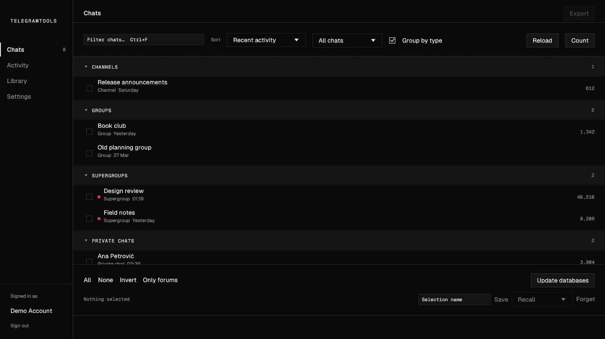

# TelegramTools

Keep your own copy of your Telegram conversations, and read them back.

- **Export** a chat as web pages you can open in any browser and as JSON,
  exactly as Telegram Desktop would write them — or as one database per chat
  that each run adds to, keeping what was later edited or deleted.
- **Report** on any export: one self-contained `report.html` beside it, with
  who talks, when, how fast people answer, and what changed. It never touches
  the network.

Forum supergroups come out as **one folder per topic**, each a complete archive
in its own right. That's the part Telegram's own exporter won't do for you.



TelegramTools used to be two programs, Telegram Exporter and Telegram
Analyser. They are one window and one exe now; see `TELEGRAMTOOLS.md` for how
and why.

## Before you start

You need an `api_id` and `api_hash` of your own. Sign in at
[my.telegram.org](https://my.telegram.org), open **API development tools**, and
register an app. It's free and takes a minute.

You sign in as yourself, with your phone number and a login code. Bots can't
read chat history, so there's no bot-token shortcut. Making reports needs no
sign-in at all.

## First run

```powershell
save.bat build          # → dist\TelegramTools.exe
```

Launch the exe and press **Sign in** at the foot of the left rail. It asks for
your API keys and phone, sends a code to Telegram, and remembers the session —
you won't do this again. **Sign out**, in the same place, ends the session at
Telegram and deletes it from this computer; it is also how you switch
accounts.

The rail has five places:

- **Chats** — tick the chats you want and press **Export** at the top right.
  **Reload** fetches the list again; **Count** asks how many messages each chat
  holds, so the list can sort by size. Right-click a chat to export just that
  one.
- **Activity** — what is running: the exports, the reports, and the log of
  both, with the speed, the time left in the chat being read, and the time
  so far. **Stop** works at any moment, and whatever was already written stays
  on disk. If the window is in the background when a run ends, Windows shows a
  notification.
- **Analysis** — every export in your destination folder, one row per chat.
  **Make report**, **Open report**, **Read** a database in the window, or
  **Show in folder**. Rows that need a report are ticked already. The search
  box on the right looks inside the messages of every database.
- **Summaries** — what happened in a chat between two days, written by a
  local model (see below). Pick a chat, the days, **Short**, **Detailed** or
  **Sections**, the whole group or by topic, and the language; press
  **Summarise**.
- **Settings** — every setting says what it does on the line under it.

Reading a database shows deleted and edited messages, every earlier version,
and the files it kept — **Save as…** writes one out, **Export as folder…**
writes the whole chat back out in Desktop's format. Filter by sender, or type
a day into **Go to date**.

Keys: **Ctrl+1–5** switch views, **Ctrl+F** jumps to the filter, **Ctrl+A**
ticks every chat shown, **Ctrl+E** exports, **F5** reloads, **Esc** clears
the filter, and **Ctrl +/−/0** zoom. The window remembers its size, place and
zoom.

## What you end up with

Everything lands in `Exports/`, beside the app:

```
Dev Team/
  0001 - General/
    messages.html        ← start here
    result.json
    report.html          ← once you make one
    photos/  video_files/  voice_messages/  files/  stickers/ …
  0042 - Backend/
  0043 - Design 🎨/
```

Open `messages.html` and you have the conversation as it looked: text,
replies, media, reactions, polls, joins and leaves, oldest message first. Media
lives in the folder next to the pages, so you can move the whole thing to a
drive, zip it, hand it to someone — it reads offline, forever, with nothing
installed. `report.html` is the same: one file, fonts and charts inside it.

Topic folders are prefixed with the topic's id. Two topics sharing a name, or
one renamed halfway through its life, can't collide.

## Settings that change the outcome

Most defaults you can leave alone. These are the ones people actually want to
change:

| | Default | |
|---|---|---|
| **Format** | Folder | Folder writes Desktop's folders; Database writes one accumulating file per chat. See below |
| **From / Until** | blank | A folder export of only those days, both included |
| **Size limit** | 20 MB | Anything bigger is skipped. `0` means no limit — a busy group can run to tens of gigabytes |
| **Download media** | on | Turn off for text-only pages, which is enormously faster |
| **Where exports go** | `Exports/` | Point it anywhere. Analysis follows it |
| **Split forum topics** | on | |
| **Member list cap** | 10,000 | Large public channels stop serving the list well before that |
| **Report after each export** | off | Writes each chat's report while the next one downloads |
| **People by @handle** | off | Reports name people by @handle, never by the name you saved them under |

### The database

**Database** is an alternative to a folder export, not an addition to it. A
folder export is written fresh every run, in Desktop's format. Database gives
each chat its own `<chat name>.sqlite` and merges each run into it, media
included — so re-running syncs instead of exporting the whole chat again.

What that buys you is the thing a folder export cannot do. Export a chat today
and again next month, and the second export simply won't contain whatever was
deleted in between. The database keeps both: new messages are added, an edited
message keeps its earlier versions, and a message Telegram no longer returns
stays in the file, marked with the date it went missing. **It can only keep
what it has already seen**, so the first export is what starts the record.

A sync reads what is new plus the newest few hundred messages again, looking
for edits and deletions. **Check the whole history** walks all of it, for
older deletions and for files an earlier run skipped. **Update databases**
under the chat list syncs every chat that already has one.

### Reports

A report reads a finished export — a folder or a database — and nothing else.
**Write the digest** also puts `digest.jsonl` and `EVENTS.md` beside it: every
message on one line, with each attached document's text and its real date, for
a language model to map events onto. **Embed fonts** keeps the report looking
right on any machine; off, it is about 300 KB smaller.

### Summaries

A summary is written by a model running **on this computer** — a
[llama.cpp](https://github.com/ggml-org/llama.cpp) `llama-server` with Gemma
loaded — and nothing is sent anywhere else: the app only ever talks to
`127.0.0.1`. You supply both, in one **models folder** — `Models\` beside the
exe, or any folder you choose in **Settings → Summaries**, which also has a
short *How to add a model*. [docs/MODELS.md](docs/MODELS.md) is the longer
version: getting llama.cpp, and picking and downloading a model from Hugging
Face. **Model** lists what is in the folder; the prompts are written for
Gemma 4 26B-A4B.

The app starts the server on port 8080 when you press **Summarise** and keeps
it loaded while you are in Summaries, so a question after a summary is
answered at once. It stops it two minutes after you leave Summaries, or when
the window closes. If another program already has Gemma running on the port,
that one is used and left running.

**Text in photos is read too** — posters, screenshots, photographed pages — by
an OCR model (PaddleOCR-VL, if you put it in the models folder), before the
summary is written, so the summary knows what they said. The card holds one
model at a time, so the app loads the OCR, reads the days' photos, then swaps
in the summary's model. Each photo is read once and remembered. **Settings →
Summaries → Read text in photos** turns it off.

If another program's model server is on the port, the Summaries view says so
under the form — which model it has loaded, and what that means: with Gemma, a
summary uses it as it is but photos can't be read; with another model, no
summary can run. **Stop it** (press twice) ends that server. The app never
does that by itself; if the other program is in the middle of a job, that job
fails or it starts the server again. Gemma 4 26B needs about 15 GB of video
memory; close other programs that use the GPU, or it spills into RAM and runs
a few times slower.

**Ask about the days.** Under the summary is a question box: "who proposed
the strike?", "what was decided on Tuesday?". The model answers from the same
days' messages, citing them — click a `[#id]` to open the message — and
remembers the conversation until you change the days or press **Clear**. You
can ask without writing a summary first. When the days are too many to read
at once, it first finds which of the summary's notes the question is about,
then reads the messages behind those notes and answers from them.

The line under the form says how many messages the days hold and roughly how
long a summary that is. A short range is read in one go; a long one is read in
parts, and the parts' notes are kept, so asking again — or for an overlapping
range — redoes only what changed. **Detailed** and **Sections** cite the
messages they rest on: click `[#18234]` to open that message. Each summary is
saved in the chat's folder, under `analysis\summaries\`, and listed under
**Saved**.

## Looking after your account

`TelegramToolsData/`, next to the exe, holds your `api_hash` and your
Telegram session key. That key **is** access to your account — anyone who can
read the folder can act as you. It's restricted to your Windows user when it's
created, though that offers nothing on a FAT32 or exFAT drive. (It was called
`TelegramExporterData/`; the first run renames it.)

If you're ever unsure, revoke the session from Telegram → **Settings →
Devices**. Reporting a problem? Settings → **Copy diagnostics** gives you the
version and settings with the credentials taken out; see `SECURITY.md` for
anything security-related.

And exports — and reports — are other people's messages as much as yours.
Store them like it.

## What it won't do

- Reach chats your account can't already see. It has exactly your access, no more.
- Bring back messages deleted before you first exported them. Those are gone
  from Telegram's servers too. Use **Database** and it will keep anything
  deleted *after* a run has seen it.
- Finish a huge forum quickly. History arrives in one sequential pass, at the
  rate Telegram hands it over.
- Run without OpenGL. If the window can't start, it says so instead of showing
  you an empty frame.

## From the terminal

The same exe takes commands. No arguments open the window.

```powershell
TelegramTools login
TelegramTools logout
TelegramTools chats
TelegramTools export "Dev Team"
TelegramTools export --since 2026-01-01 "Dev Team"   # only from that day on
TelegramTools export --db "Dev Team"          # database instead of folders
TelegramTools export --db --full "Dev Team"   # walk the whole history
TelegramTools sync                            # update every database in Exports
TelegramTools sync --json                     # the same, with a JSON summary

TelegramTools analyse "Exports\Dev Team"      # write report.html beside it
TelegramTools analyse Exports --refresh       # every export whose report is behind

TelegramTools summarise "Exports\Dev Team\Dev Team.sqlite" --from 2026-01-05 --to 2026-01-11 --detailed
```

`summarise` takes `--short`, `--detailed` or `--sections`, `--by-topic` or
`--topic <name>`, `--lang sr|en|chat` and `--port`; it needs a model server
already running (`TelegramTools summarise --help`).

`analyse` also takes `--digest`, `--handles`, `--no-fonts`, `--notes <file>`
and `--out <path>`. From `cmd.exe`, use `start /wait TelegramTools …` — it is a
windowed exe, and cmd does not wait for one by itself. PowerShell does.

`TG_API_ID` and `TG_API_HASH` work instead of the settings file.

To have another program or an AI agent update the databases and read the
chats, see [docs/AI.md](docs/AI.md).

## Building

`save.bat` with no arguments gives you a menu; `save.bat test` runs formatting,
lints and the full suite, and `save.bat build` produces the release exe in
`dist/`. That folder is self-contained — copy it to a stick and it works there.

Rust, [egui](https://github.com/emilk/egui) and
[grammers](https://github.com/Lonami/grammers).

## Licence

Copyright © 2026 Kosta Jovanovic.

TelegramTools is free software: you can redistribute it and/or modify it under
the terms of the GNU General Public License as published by the Free Software
Foundation, either version 3 of the License, or (at your option) any later
version. It is distributed in the hope that it will be useful, but **without
any warranty**; without even the implied warranty of merchantability or
fitness for a particular purpose. See `LICENSE` for the full text.
